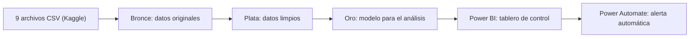

# Proyecto integrador Data Analyst: análisis del dataset público Brazilian E-Commerce

Proyecto de análisis de datos de principio a fin: se parte de 9 archivos CSV de pedidos de comercio electrónico y se avanza hasta un tablero de control con indicadores y una alerta automática.

## Contexto

Olist es una tienda en línea de Brasil. El dataset reúne **99,441 pedidos realizados entre septiembre de 2016 y octubre de 2018**, con información de clientes, vendedores, productos, pagos, reseñas, entregas y ubicaciones.

**Fuente:** [Brazilian E-Commerce Public Dataset by Olist (Kaggle)](https://www.kaggle.com/datasets/olistbr/brazilian-ecommerce). Los datos pertenecen a Olist; las condiciones de uso están en la página del dataset. Los archivos originales no se incluyen en este repositorio.

## Preguntas de negocio

El proyecto busca responder preguntas como:

- ¿Cuánto se vende y cómo evolucionan las ventas mes a mes?
- ¿Qué categorías de productos venden más?
- ¿Qué porcentaje de los pedidos llega a tiempo?
- ¿Qué tan satisfechos están los clientes?
- ¿Cuánto se factura frente a lo que se cobra?

## Cómo fluyen los datos

Los datos pasan por tres capas, cada una más limpia que la anterior:

| Capa | Qué contiene |
|---|---|
| **Bronce** | Los datos tal como llegaron, sin cambios |
| **Plata** | Los datos ya limpios y unificados |
| **Oro** | Los datos listos para el tablero de control |

Todo se desarrolla en Databricks, y el tablero y la alerta se construyen con Power BI y Power Automate.

## Fases y estado

| Fase | Herramienta | Estado |
|---|---|---|
| Carga de los datos (Bronce) | Databricks | Completada |
| Revisión de la calidad de los datos (EDA) | Python en Databricks | Completada |
| Limpieza y unificación (Plata) | Databricks | Pendiente |
| Modelo para el análisis (Oro) | Databricks | Pendiente |
| Tablero de control con indicadores | Power BI | Pendiente |
| Alerta automática | Power Automate | Pendiente |

## Estructura del repositorio

| Carpeta | Contenido |
|---|---|
| `notebooks/` | Los cuadernos de trabajo de Databricks, numerados en el orden en que se ejecutan |
| `docs/` | La documentación del proyecto |

| Archivo | Qué hace |
|---|---|
| `notebooks/01_crear_catalogo_y_schemas` | Crea el espacio donde viven los datos (catálogo y capas) |
| `notebooks/02_carga_bronce` | Carga los 9 archivos CSV como tablas de la capa Bronce |
| `notebooks/03_eda_calidad_datos` | Revisa la calidad de los datos |
| `docs/eda_hallazgos.md` | Resume los problemas encontrados y qué se hará con cada uno |

## Revisión de la calidad de los datos (EDA)

Se revisaron las 9 tablas buscando datos faltantes, filas repetidas, valores fuera de lo normal, conexiones rotas entre tablas, fechas incoherentes y diferencias entre pagos y productos. Se documentaron **36 hallazgos**, cada uno con la regla que se aplicará en la capa Plata. El detalle completo está en [`docs/eda_hallazgos.md`](docs/eda_hallazgos.md).

**Lo que está bien**

- Los 9 archivos se leyeron completos y sin perder filas.
- Los identificadores de 7 tablas no se repiten.
- 6 de las 7 conexiones entre tablas están completas: ninguna fila apunta a algo que no existe.
- En el 99.75% de los pedidos, el total pagado coincide con el total de los productos.

**Lo que se corregirá en la capa Plata**

| Problema | Cantidad | Qué se hará |
|---|---|---|
| Ubicaciones repetidas | 261,831 filas idénticas (26% de la tabla) | Eliminar las copias |
| Pedidos con más de una reseña | 547 pedidos | Dejar la más reciente de cada pedido |
| Productos sin categoría | 610 (todos vendidos, el 1.4% de las ventas) | Conservarlos con la categoría `sin_categoria` |
| Pedidos con fechas fuera de orden | 166 y 23 pedidos | Conservarlos y marcarlos con una columna de aviso |
| Pedidos entregados sin fecha de entrega | 8 pedidos | Conservarlos y marcarlos con una columna de aviso |
| Puntos de ubicación fuera de Brasil | 27 puntos | Excluirlos |

La regla general es **conservar los datos dudosos y marcarlos**, en lugar de borrarlos, para no perder ventas reales.

**Reglas clave para los indicadores**

- Las ventas se calculan **solo con pedidos entregados**: los cancelados, no disponibles y en proceso tienen pagos registrados, y sumarlos haría que las ventas salgan un 3.8% más altas.
- Los clientes se cuentan con `customer_unique_id`, porque el identificador por pedido cuenta de más a 3,345 clientes que compraron varias veces.
- El monto facturado es el precio más el flete, y el monto cobrado es la suma de los pagos.

## Herramientas

Databricks (Unity Catalog), Python, SQL, Power BI y Power Automate.